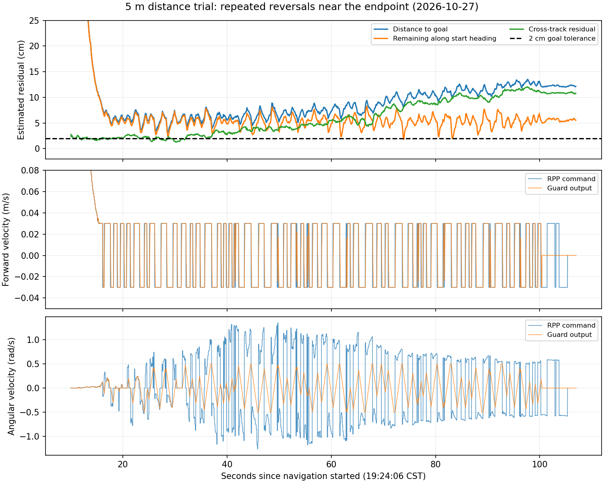

# 2026-10-27 19:24 距离测试末端折返与摆动

状态：已确认路径末端存在人为折返、RPP反复前后切换；已修正插件并通过离线回归，实车复测尚未执行。物理测距偏短18cm尚未建立独立因果结论。

## 输入和有效配置

- bag：bags/field_trial_20261027T112336Z_6a667c68，覆盖约151.17s、109152条消息，约2.1GB。
- 会话：runs/20261027T112311Z-b55999d3/process.log；冻结快照：runs/field_trial_20261027T112312Z_41156b1e。
- 任务：missions/forward_20261027T112350Z_7f22f329，起点 (19.3409682004,-9.2092580581)，朝向 -0.1014685668 rad，目标 (24.3152506021,-9.7157307506)。目标距离5.0m。
- 本轮 planning_profile=distance，日志明确加载 agt_field_test_bringup/ExactGoalPlanner。本轮并非此前普通navigation配置的重复误用。2cm目标判定来自distance启动配置；录包参数事件没有完整保留全部controller参数，不能把源码配置误称为本包参数读取快照。

## 录包证据

1. 全局路径只发布1次，终点与目标一致；其最大横向偏离起始直线约1.73cm，路径基本平直。本轮的持续摆动不需要全局路径反复重规划来解释。
2. 原末端格点 (24.3250018,-9.7249995) 沿原始方向超过目标1.064cm、横向偏8.23mm；之后追加精确目标，形成回头段。最后两段点积为负，构成人为方向反转尖点。
3. /lookahead_point 位于base_link，19:24:22.399首次出现 x=-0.0531m，控制器把跟踪点选到了车后；这与反复正负速度输出相对应。
4. 19:24:21–19:25:52附近统计，非零线速度正负切换119次，主要在+0.03/-0.03m/s间切换。RPP原始角速度峰值约1.3504rad/s；最终/mux/cmd_vel仍被约束在±0.5rad/s，但来回变化未被消除。
5. 将/agt/odometry/local与同期map->odom组合，19:24:34.890曾距目标约3.226cm（纵向剩余2.479cm、横向2.064cm），未进入2cm到点半径。随后定位坐标中的横向残差逐渐扩大，结束附近距目标约12.1cm。此处为软件位姿残差，不是独立物理测距。
6. /bunker_status 在19:24:06.256从control_mode=3切到1，在19:25:46.716切回3；后者之后/mux/cmd_vel归零，19:25:51.619 Failed to make progress、19:25:51.646 Goal failed。末次5秒无进展与退出CAN自动控制的时间对应，不能全归因于控制器；此前约80余秒摆动发生在control_mode=1、底盘正常状态下。摆动期间位姿/朝向变化可反复满足progress checker，不能把5秒无进展时限当作整个终点微调阶段的总时间上限。

## 机制与修正

此前ExactGoalPlanner在Smac末点后直接追加精确目标。如果栅格中心越过目标，最后一小段反向；允许倒车的RPP会将方向反转尖点纳入前视距离/方向选择。很短的前视点还会使纯跟踪曲率放大，结合履带实际响应和平滑器滞后，容易持续前后、左右切换。记录支持此机制；尚未做同一实车条件下修正前后A/B。

插件现替换终端格点，并在新连接会造成反向折点时向前退选连接点，然后重新执行整段5mm采样和车体轮廓碰撞检查，连接至精确目标。原生搜索、障碍约束、未知区域拒绝与倒车能力均保留。不通过放大到点容差掩盖折返。

## 验证与边界

- 使用现场相同的小数格点位置和朝向（平移至隔离地图内）增加原生规划器回归：旧实现稳定失败，末段点积为负；修正后通过，精确终点仍成立且无反向尖点。
- agt_field_test_bringup编译完成，安装插件已更新。
- 私有ROS_DOMAIN_ID=183、ROS_LOCALHOST_ONLY=1，无物理控制器：31项距离规划/参数提交/任务生成测试通过，含障碍、未知区域和不可达目标拒绝。
- 未完成实车停车、物理距离和修正后控制器动态验证。操作者称偏短18cm，与本包最小估计残差3.2cm并不等价；若修正后仍存在固定短行程，应检查实际测距参考点、起终朝向、LIO与轮速累计距离及外参/轮速尺度，而非直接增加18cm目标补偿。

本地详细数组和脚本：work/distance_endpoint_20261027_1924。原始bag仍只保存在本机，Git仅保存报告、汇总和图。

停车结束旧会话后重新 ./field_start distance，再录包执行 ./field_distance run 5；无需现场自动试车即可完成本次代码更新。
