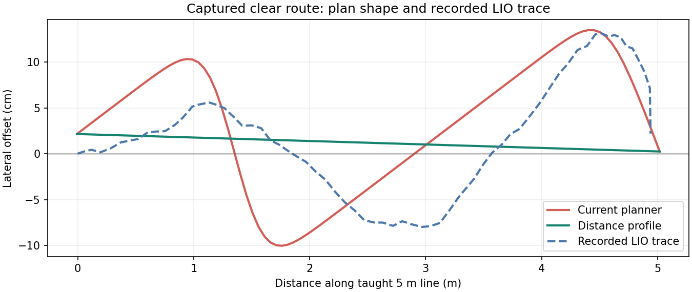

# 距离测试空地路径折弯

操作者报告 5 m 距离准确，但车在空地仍左右走弯。现场只读采样保存在工作区 `runs/path_shape_20261025/`。该次起点 (18.329844, -9.197155)，终点 (23.306885, -9.675756)，方向 -0.095867 rad。

实际运行配置：SmacPlanner2D，0.05 m 栅格，`cost_travel_multiplier=3`，`allow_unknown=false`，默认平滑 `w_smooth=0.3,w_data=0.2`；RPP 跟踪，速度 0.4 m/s，前视距离 0.8 m。全局膨胀半径 1 m、衰减 2；局部膨胀半径 0.85 m、衰减 2。

沿教示直线每 1 cm 采样，全局代价均为 0；左右各 0.3 m 的平行线亦为 0。另采样两条累计 LIO/轮速轨迹、地图和局部代价地图。任务结束后仅通过 ComputePathToPose 查询相同起终点，不发送 NavigateToPose、FollowPath 或速度命令。查询出的旧规划存在 8 邻域搜索形成的左右折弯；从现场静态地图在私有 DDS 中重新计算，得到相同的旧路径。

Smac 原平滑的数据项会把路径吸附在搜索得到的折线上。修复只为距离模式选择 `planning_profile=distance`，将原 Smac 内部平滑的 `w_data` 设为 0，迭代上限设为 100000，保留既有总规划时间预算。无障碍时路径趋于连接两端栅格中心的直线。保留相同规划器、搜索代价、footprint、RPP 碰撞检查、速度限制和到达判定。

Humble Smac 的平滑允许经过 unknown，即使搜索禁止 unknown。障碍回归中发现，单独放松数据项会让未知块旁的路线切角。因此距离配置同时启用全局膨胀层 `inflate_around_unknown` 和 `inflate_unknown`，保护未知区边界；普通导航/拍照不启用这些覆盖。距离测试应在已观测空地进行，未知区域边缘的可行通道可能比原配置窄。

使用相同捕获地图的最终配置回放：

| 指标 | 原配置 | 距离配置 |
|---|---:|---:|
| 规划相对教示直线最大横向偏差 | 0.13508 m | 0.02159 m |
| 规划路径长度 | 5.09178 m | 5.02494 m |
| 路径点数 | 101 | 101 |
| 本次离线 Action 查询墙钟耗时 | 0.1913 s | 0.0632 s |

查询墙钟耗时包括通信和等待，不能当作严格的规划算法基准。修复后剩余约 2 cm 偏差与起终点落在 5 cm 栅格中心有关。旧累计 LIO 轨迹相对教示直线约 -8.0～+13.2 cm；它是定位轨迹，不是外部测量真值。**新配置实车轨迹尚未采集，不声称新实车横向精度已达 2 cm。**



`comparison.json` 保存指标；`replayed_plans.json` 和 `recorded_lio_path.json` 保存图中数据。原始地图、代价快照和只读采样脚本留在本地 runs，未修改地图或标定。

仅构建 `agt_field_test_bringup` 成功。回归使用 `ROS_DOMAIN_ID=183 ROS_LOCALHOST_ONLY=1`，只启动原生 planner_server 和测试地图/TF，没有控制器、底盘或相机。**104 项通过**，结果见 `regression.txt`、`regression.xml`，包含：

- 5/8/12 m 空地路线，最大横向偏差 <4 cm，查询时间 <2.2 s；5 m 明显优于原配置。
- 直线有实障碍、未知块时必须绕行；对每条路径所有线段以 1 cm 间距检查，不穿越障碍/未知单元；未知墙阻断全地图时返回规划失败。
- distance 配置经组合入口、field_trial、launch 一直传到实际 Nav2 参数；nav/photo 默认保持原配置，定位/底盘/速度/到达门槛断言继续通过。
- 原有启动响应重试、真实 Humble runtime、TTY 助手、距离任务和拍照流程回归。

复现命令（在 Workbench 仓库目录）：

```bash
ROS_DOMAIN_ID=183 ROS_LOCALHOST_ONLY=1 PYTEST_DISABLE_PLUGIN_AUTOLOAD=1 PYTHONPATH="$PWD" \
  bash scripts/ros_exec.sh python3 -m pytest -q \
  tests/test_distance_planning_ros.py tests/test_field_trial.py \
  tests/test_ros_parameters.py tests/test_mode_state.py tests/test_field_distance_ros.py \
  tests/test_field_start_ros.py tests/test_field_runtime_process.py tests/test_field_start.py \
  tests/test_field_start_tty.py tests/test_field_clock.py tests/test_field_tasks.py tests/test_field_photo.py
```

代码与配置改动未在线改变现场会话。下一次停车、结束原组合入口后重新执行 `./field_start distance` 即加载新距离配置；最终就绪后由操作者显式执行 `./field_distance run 5`。保留原起点和任务文件。没有移动依赖 HEAD、地图版本或里程计时间戳。
