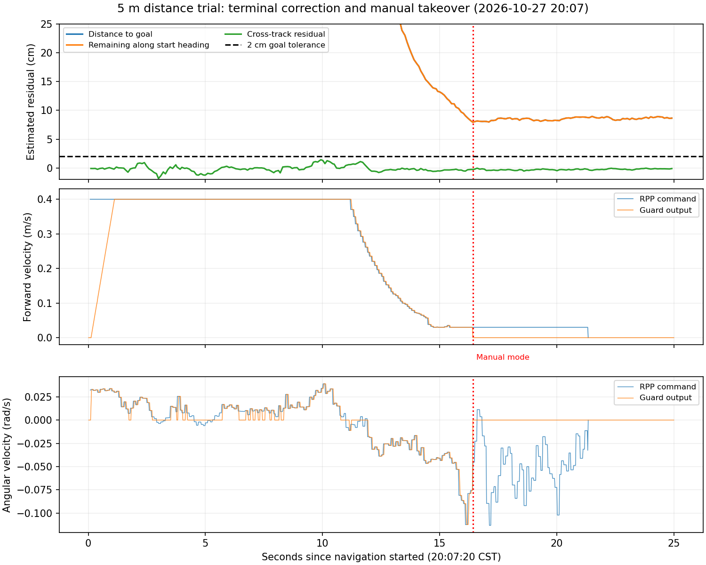

# 2026-10-27 20:07 距离测试：末端转向、高度投影与行程偏差

状态：本包分析完成。已确认旧反向尖点不再出现，控制器跟踪点受到三维高度/姿态投影影响，外部安装俯仰存在需复核的残差；固定13–15cm物理误差的全部因果尚未闭环。本次未修改外参或导航控制实现。

操作人员反馈：路线很直，实际稳定偏短约13–15cm，接近终点有左右调整，之后主动切回手动；地面为平整水泥地。RTK本轮暂不作为参考，按操作人员要求停止进一步RTK归因。

## 原始证据与任务

- 导航bag：bags/field_trial_20261027T120647Z_3da4cd2d，77.057s、47435条消息。
- 运行日志：runs/20261027T120553Z-8068fee6/process.log；快照 runs/field_trial_20261027T120554Z_14a55fb3。
- 任务：missions/forward_20261027T120713Z_7cba46ff，起点(19.33125595,-9.24750461)，yaw=-0.08798524rad，目标(24.31191492,-9.68686341)，距离5m。
- 已加载ExactGoalPlanner。/plan只有1次，末点精确落在目标，最大横向偏离约2.19cm，长度5.0104m；相邻末段无负点积、控制输出没有前后切换。旧末端折返已消除。

## 时间线及手动接管

20:07:20.786控制模式3切到1（CAN自动），20:07:20.813导航开始。20:07:37.228切回模式3，/mux/cmd_vel归零；此时在软件估计中仍距目标约8cm。20:07:42.154 Failed to make progress，随后任务失败。操作者确认接近终点后主动手动接管，不能把最后的零速/超时解释为控制器已自主到点。

接管前原始角速度最大约0.113rad/s，低速段大约0.03m/s；本包没有上一轮119次前后切换。接管后的/cmd_vel_nav仍有微调计算，但/mux/cmd_vel为零，不能将这些零输出后的指令当成车体继续自动摆动。

## 已确认的二维控制投影问题

规划路径z=0；本包map中base_link高度约-0.8m，俯仰约2.6–2.85度、滚转约-0.3度。将二维路径点按完整三维TF转入base_link后，地图高度差耦合进局部x/y误差。记录中的/lookahead_point与三维计算一致，而与平面位置/航向计算不同。

20:07:37.132的同一目标：

| 计算方式 | 车前x | 左侧y |
| --- | ---: | ---: |
| 只使用平面位置和航向 | 0.082369m | +0.002091m |
| 完整三维目标变换 | 0.042141m | -0.002241m |
| 实际/lookahead_point | 0.042144m | -0.002245m |

由此造成约4.02cm前向虚偏差、约4.33mm横向虚偏差，横向符号已经反转。取速度0.03m/s，用纯跟踪公式 omega=2*v*y/(x²+y²)：

- 平面目标应对应约+0.01848rad/s；
- 实际跟踪点给出-0.075613rad/s；
- 同时刻录包/cmd_vel_nav实际就是-0.075613rad/s。

该数值闭合支持：高度/姿态投影是临近终点错误转向修正的具体诱因。发布的carrot z=0.01只是显示高度；xy已经经过三维变换，不能靠改显示z修复。路径本身走直不代表末端局部跟踪几何正确。

## 外参核查

快照安装T_base_livox：xyz=(0.40607474,0,0.72746812)m，pitch=13度；内部IMU/LiDAR旋转为单位阵，平移(-0.011,-0.02329,0.04412)m。

- 原始body起终水平位移4.89907m，转换后的base位移4.89712m。外部参考点转换只贡献约-1.90mm前向变化、+22.54mm侧向变化；起终朝向改变约3.2度。没有证据证明固定安装平移直接制造了13–15cm纵向偏差。
- odom中base俯仰约2.86–2.96度，起终高度变化约-5.55cm。这是估计姿态/轨迹，不能替代车体水平测量。
- 用静止前后4帧原始/agt/livox/points，按当前13度外参转到base，选1–5m、z=[-0.65,0.25]m候选点拟合地面。四帧平面纵坡角2.13–2.24度、滚转坡角绝对值<0.07度；内点占比90.8%–92.7%，平面拟合RMSE约3.8–4.0mm。
- 若该水泥地与车体几何基准平行，俯仰安装角候选约15.1–15.2度；这是离线候选，必须考虑地面坡度、车体姿态、支架与传感器坐标约定，未应用或标为正式标定。

约2.2度外参残差的简单5m投影误差只有约3.7mm；不能直接解释13–15cm。但当路径和车体相差0.8m高度时，约2.8度俯仰会引入约4cm的局部跟踪点偏移，因此末端控制影响显著。

## 行程差异与物理精度边界

以导航前稳定窗口20:07:15–20:07:20与接管后20:07:44–20:07:50比较：

| 来源 | 水平位移 |
| --- | ---: |
| map中base估计 | 4.91067m |
| odom中base估计 | 4.89712m |
| 轮速里程计 | 4.77754m |
| 轮速线速度积分 | 4.77798m |

匀速段LIO位置变化率中位约0.40638m/s，轮速约0.39450m/s，相比约+3.01%。这证明二者尺度/运动估计不一致，不证明哪一个就是真值；不能直接给LIO或轮速乘一个修正系数。

操作人员报告实际4.85–4.87m，而本次软件估计4.91m、尚余约9cm就接管，最终13–15cm短行程不能全归因于单个规划器参数。如果测量参考点和时间窗一致，这些数值可能包含约9cm未完成的目标距离，以及LIO对实际位移约4–6cm的高估；该分解为条件推算，不是独立真值验证。需要同一物理参考点、起终朝向和卷尺刻度证据确认。

## 后续修复顺序

1. 先在隔离控制器测试中修复二维路径与三维姿态之间的平面投影契约，使carrot的xy只由真实平面位置与航向决定，验证不同map高度与roll/pitch下同一二维路径给出一致转向，并保留碰撞检测与命令约束。不能仅将base_link TF拍平，因为点云变换与车体几何还依赖真实三维姿态。
2. 独立复核安装俯仰与车体基准；15.2度仅作候选，验证后再统一更新标定包和重定位/导航所用变换，避免只改单一节点造成不一致。
3. 使用卷尺固定起终参考点完成一次短低速测试，分别记录首次进入2cm软件半径与实际稳定停止；比较LIO/轮速/物理位移。先完成上述几何和参考定义，再决定是否存在需要校正的里程计尺度或低速控制问题。

原始数组、投影计算、点云平面拟合脚本保存在work/distance_endpoint_20261027_2007。报告中RTK比较只作为数据可用性记录，不作为本轮误差定量依据。
