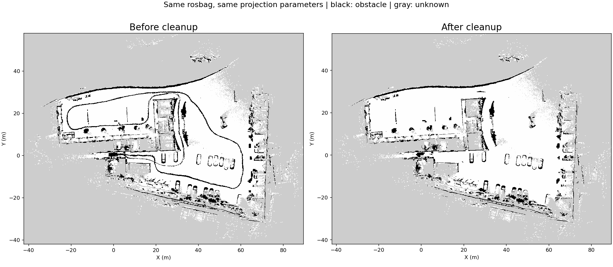
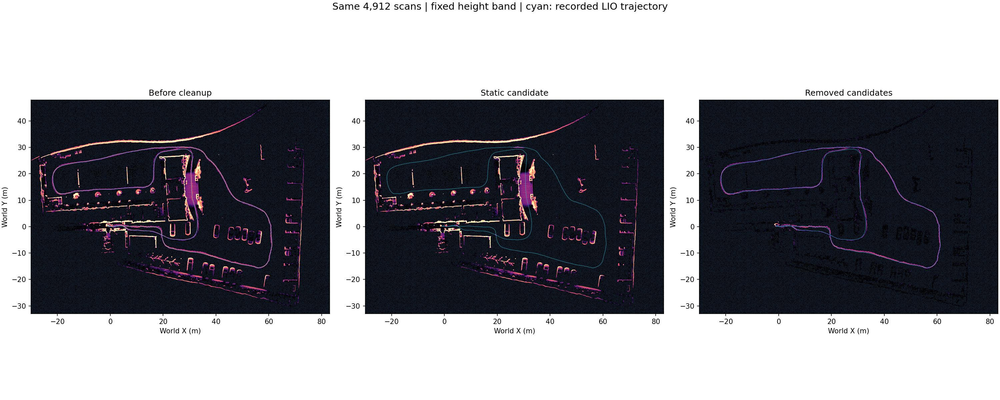

# 农科院整包回放：漂移修复与残影清理

同一份 491.36 秒 rosbag，4,914 条雷达消息、98,265 条 IMU；修复后导出 4,912 帧，
全部精确匹配位姿。此次仅离线回放，未发运动命令，未切换现场 active map。

## 清理前后图片

左侧清理前，右侧清理后。二维使用同一份 rosbag、同一套 local_ground 投影参数。
黑色为占用、白色为自由、灰色为未知；占用格减少不等于实车通行验收。

三维俯视图依次为：清理前、静态候选、移除候选；青色为实际回放 LIO 轨迹。
沿行驶轨迹的长线明显减少，主要结构仍保留。起点附近仍有持久点团。

[三维局部细节](cleanup_detail.png) · [二维局部细节](grid_cleanup_comparison.png)

- 输入点 10,201,128；车体范围过滤 95,363。
- 静态证据不足的移除候选 347,600；保留 9,758,165。
- 额外保留近场/单次观测地面 50,621 点。
- 地图候选名称：`bunker 农科院 建图测试1 去残影候选`，状态 DRAFT。
- 无语义人体检测；长期停留的人可能保留，仅近距离出现的真实结构也可能被误筛，需查看移除候选。

## 漂移修复证据

[修复后的三维图](corrected_map_topview.png) · [修复后的二维图](corrected_grid_preview.png)

完整说明：[漂移排查](../../mapping_drift_20261024.md)、[残影清理链路与边界](../../map_cleanup_20261024.md)。
[验证摘要与输入 SHA](summary.json)、[轨迹数值检查](trajectory_quality.json)、
[二维 A/B 指标](grid_comparison_metrics.json)、[最终安装程序输出一致性](installed_equivalence.json)。

## 代码与可复现性

Workbench 分支 `feature/agt-robot-studio-v1` 保存 C++ 时间对齐、轨迹拒收检查、逐帧索引、
清理接入、测试、下列两个依赖的精确补丁及前后哈希。

- 建图导出器：[fix/field-map-cleanup-20261024](https://github.com/Aldoubt/agt-lio-pgo-mapping/tree/fix/field-map-cleanup-20261024)，
  提交 [`be2d1c1`](https://github.com/Aldoubt/agt-lio-pgo-mapping/commit/be2d1c16c1c38f878eec903e3ae5cd3da868f2a7)。
- FAST-LIO2：[fix/field-mapping-jacobian-20261024](https://github.com/Aldoubt/fast-lio2/tree/fix/field-mapping-jacobian-20261024)，
  提交 [`187f844`](https://github.com/Aldoubt/fast-lio2/commit/187f8446cce0d91248708e820cef7cb89bc7335f)。

[发布清单](dependency_publications.json) 记录依赖基线、提交和每个修改文件的 SHA256。
本地两个依赖的锁定 HEAD 保持不变，以相同基线加精确补丁构建；不要直接切换到这些
源码快照分支后再套同一补丁。`build_humble.sh` 会自动应用并审计补丁。

`analysis/` 保存本次回放观察器和绘图脚本原件。它们记录的是当时本机实验目录，
不是可在任意机器直接运行的入口；需取得原始数据并调整 ROOT/BAG/BUNDLE/实验路径。
产品清理入口为 `workbench/map_cleanup.py`，由 Bunker FAST-LIO 保存流程自动调用。
原始 rosbag、大型 PCD、build/install 缓存保留在现场机器；本目录仅发布代码、图表及验证摘要。
