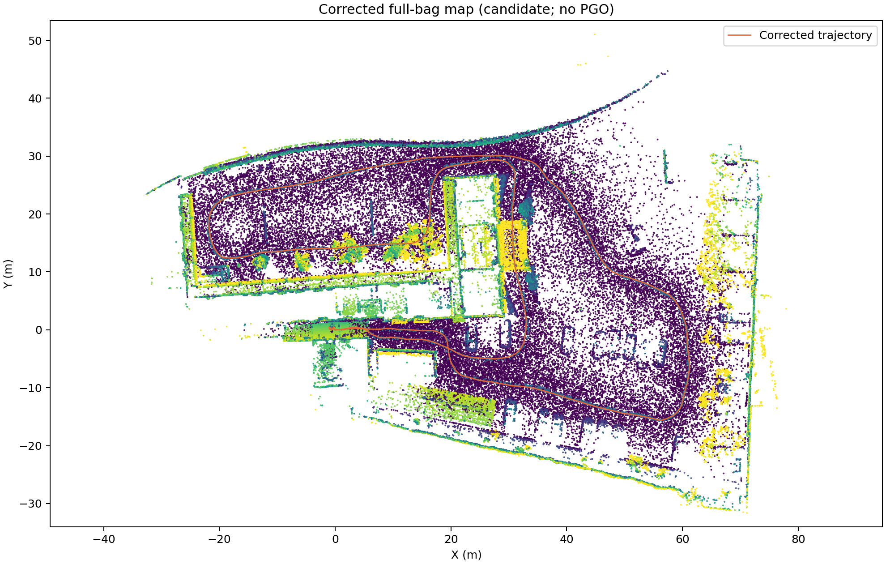
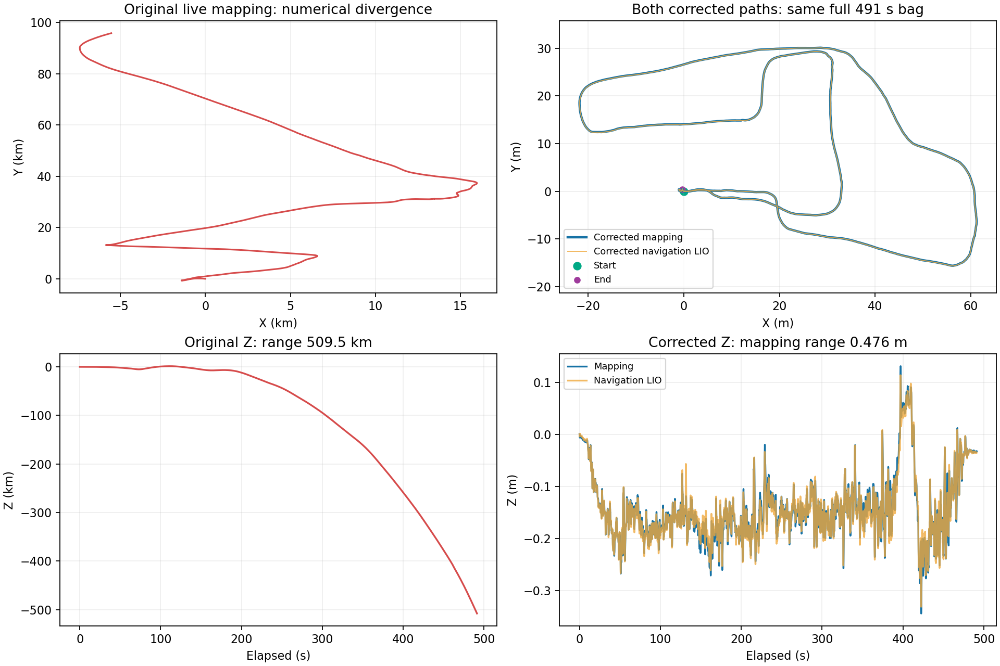

# 农科院最新 rosbag 建图漂移排查与修复

结论：当前工作区确实带有旧的 FAST-LIO2 姿态雅可比错误；本次灾难性数值发散的直接触发因素，则是 Python 时间对齐中转严重丢失 IMU。两处已经修复并重建到当前 install，保持 FAST-LIO2，无需先替换前端。

## 数据与输入核查

原包：`/home/yangxuan/agt_field_test_ws/maps/20261024T112750Z-c714f7dc/raw_bag`，约 491.36 秒，4914 帧 LiDAR、98265 条 IMU。SQLite 检查为 ok，两个 topic 无时间戳回退或重复。所有雷达帧约 1.93–2.08 万点，单帧约 100 ms，没有小包或超过 200 ms 的帧。每点时间在包内可以乱序，前端已有排序；这不等于 topic 时间戳回退。录包文件前后 SHA256 一致。

IMU 初始静止段加速度模长约 1，符合本驱动的 g 单位输入；本次没有改变 IMU 缩放、外参、时间偏移或过滤阈值。

## 因果证据

- 原源码固定在 `7f664a6`，姿态雅可比使用了世界位置 `t_wi`。右乘姿态扰动应作用于 `R_il * p_l + t_il`；修复公式通过 500 组数值微分测试，最大误差约 4e-8，旧公式在该测试最大误差约 298。
- 在旧 Python 中转链的 10 秒窗口，上游观测到 1885 条 IMU，下游只有 56 条。节点 CPU 接近单核 100%，点云回调阻塞 IMU 回调，SensorDataQoS 深度不足以保留积压数据。
- 只修雅可比、仍用 Python 中转，完整同包回放仍发散。
- 保留旧雅可比、改用 native 中转，80 秒前缀没有灾难性发散。这说明不能把本次全部漂移归因于雅可比；该短对照也不证明旧雅可比完整运行安全。
- 修复雅可比 + native 中转后，建图和导航前端都完成了完整同包回放。

## 完整回放结果

| 指标 | 原始实录建图 | 修复后建图 | 修复后导航 LIO |
|---|---:|---:|---:|
| 轨迹点 | 4493 | 4912 | 4911 |
| 累计路程 | 551250.84 m | 318.62 m | 318.64 m |
| Z 跨度 | 509528.58 m | 0.476 m | 0.445 m |
| 最大相邻位移 | 1864.29 m | 0.112 m | 0.113 m |
| NO Effective Points | 2601 | 0 | 0 |

完整修复回放的建图和导航适配器拒收计数均为 0。时间对应的两条前端轨迹中位差约 0.033 m，95 分位约 0.060 m；这属于两条链的一致性证据，没有独立真值，不是绝对精度证明。建图起终点距离约 0.535 m，未证明起终点是同一物理姿态，不能直接称作闭环误差。

## 已落地修改

1. FAST-LIO2 修正姿态雅可比，并添加直接调用生产公式的数值微分回归测试及启动版本标记。
2. `time_align.py` 保留为兼容入口，执行 C++ `time_align`。消息、点序、每点 offset_time 不变，仍只应用显式 header/timebase 偏移；IMU 与点云均采用原生消息传输。
3. 新增轨迹数值检查，在导入点云及生成二维网格之前拒绝非有限值、时间反向、不可能速度/跳变等情况。原失败轨迹被该检查拒绝。通过检查仍只是数值合理，不是地图验收。
4. 将外部前端修复保存为 `patches/frontend_manifest.json` 与精确补丁。支持新检出应用、重复应用和校验；碰到其他本地修改会停止并保留。构建脚本会应用补丁，审计仅允许精确匹配该补丁的源码。
5. 新地图 manifest 记录前端和时间对齐程序的二进制 SHA256。

当前安装路径：`/home/yangxuan/agt_field_test_ws/install/fastlio2/lib/fastlio2/lio_node` 与 `/home/yangxuan/agt_field_test_ws/install/agt_field_test_bringup/lib/agt_field_test_bringup/time_align`。已按当前源码重建。安装后 30 秒复核输出 292 条前端/底盘里程计，拒收 0；另一次并行验证时的 20 秒试验出现 8 条瞬时拒收，未捕获具体原因，记录保留，未放松时间门限。

构建复现需保留原有排除项：`--packages-ignore ugv_sdk bunker_base`。第一次未加排除项时缺少这两个不参与本工作区构建的包环境；补上后 bringup 构建通过。PCL pcap/png 功能警告仍存在，不影响本次接收或建图。

## 导航影响范围

`fastlio_navigation_lio.launch.py` 调用同一个 `fastlio2/lio_node`；现场 bundle 路径还会复用同一个时间对齐入口。因此两个缺陷都影响该工作区的 FAST-LIO2 导航 LIO 路径，修复已同时覆盖。导航原始数据分支和带 native 时间对齐的完整分支均做了离线回放。

Batch-LIO 使用另一套测量模型，检查到它使用 IMU 坐标系点构造雅可比，未发现同一处 t_wi 错误；本次没有执行 Batch-LIO 性能或精度验收。共享时间中转的修复也适用于该分支。

没有运行实车 Nav2、重定位后端或发运动指令。本次不宣称实车导航通过。

## 地图产物

- GUI 名称：**bunker 农科院 建图测试1 修复回放**。
- 点云 ID：`20261024T121130Z-f0c786f8`，约 1020 万点。
- 二维地图 ID：`20261024T121141Z-88b7e986`，2637 × 1997，分辨率 0.05 m。
- 地图 YAML：`/home/yangxuan/agt_field_test_ws/maps/versions/20261024T121141Z-88b7e986/map.yaml`。
- 状态：DRAFT；未构建 BBS 资产、未切换 active map。原错误结果和原包均保留。

## 验证与保留事项

- 新增补丁/幂等性/保留修改及轨迹检查测试：6 passed。
- 数值微分 CTest：通过。
- native 传输测试：零偏移和 IMU +12ms / LiDAR -3ms 两组，分别 400/400 IMU、20/20 大点云，逐字节一致。
- 既有相关用例：8 passed；1 个旧 UI 文案断言在未修改的 HEAD 已失配，没有修改 UI 或测试来伪造全绿。
- 依赖审计识别 FAST-LIO2 为 EXPECTED 精确补丁，无额外 dirty 依赖。导航仓库实际 SHA `2d19bf4` 与锁文件 `b3a6048` 不一致是既存状态，未回退、未重置，也没有将全仓库审计标记为 PASS。
- Python Humble 观察器只记录到 TF 边及发布者列表，未独立获得每条 TF 消息的 GID，因此没有声称逐边 authority 现场验收完成。

原始、初始失败和所有对照日志均在当前实验目录，详细数值、程序哈希和测试结果见 `report.json`。
