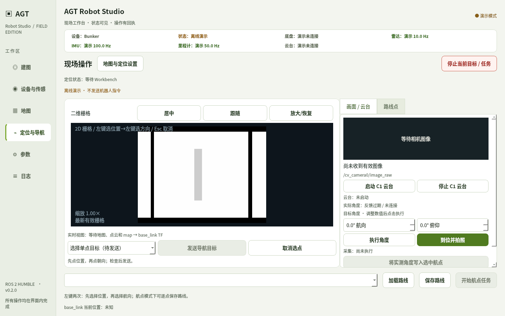

# 新操作界面实机试用

2026-10-26 更新：新增 [三主题预览与数据链路说明](ui_styles/README.md)，软件右上角可实时切换。
导航动作采用 [关联回执协议](operator_action_protocol.md)。部署本轮更新需同时更新并重启常驻 Workbench / ROS 桥；
只重开 Qt 不会更新旧后端，缺少新协议时界面会阻止新运动并提示原因。

本入口面向已经部署 Ubuntu 22.04 / ROS 2 Humble、底盘和传感器依赖的工控机。桌面安装只创建用户启动器和菜单项，不启动机器人，也不安装或替换 ROS、标定、地图、模型和现场配置。



## 构建并安装桌面入口

试用分支为 `codex/operator-ui-bbs-20261026`。在实际工作区操作，先记录现有分支、HEAD 和未提交改动，不覆盖现场标定。以下布局与仓库 README 的首次部署布局一致；将工作区路径替换为目标机实际路径。若源码已经更新到本分支，可从第二个 `cd` 开始：

```bash
cd ~/agt_field_test_ws/src/agt_field_test_workbench
git status --short
git rev-parse HEAD
git fetch origin codex/operator-ui-bbs-20261026
git switch codex/operator-ui-bbs-20261026
cd ~/agt_field_test_ws
source /opt/ros/humble/setup.bash
source install/setup.bash
colcon build --base-paths src/agt_field_test_workbench/agt_robot_studio \
  --packages-select agt_robot_studio --symlink-install
bash src/agt_field_test_workbench/scripts/launch_studio.sh --workspace "$PWD" --check
bash src/agt_field_test_workbench/scripts/install_studio_desktop.sh --workspace "$PWD"
```

如果 `git switch` 提示现场文件冲突，先保留并合并这些修改；不要强制覆盖。已存在的本地同名分支也需要核对是否包含交付提交。上面的构建只更新 Qt 包，不替代首次工作区构建，也不会重新编译 BBS 原生修复；BBS 更新按其交付说明单独执行。目标机使用 ROS Humble 对应的系统 Python，不复用云端测试虚拟环境。缺少 Qt 依赖时先安装 `python3-pyqt5 python3-numpy python3-yaml`，再执行 `--check`。

菜单中打开“AGT 机器人工作台”。应用快捷菜单还提供“离线界面演示”。也可执行：

```bash
~/.local/bin/agt-robot-studio --demo
~/.local/bin/agt-robot-studio --check
```

启动器加载所选工作区的安装结果，所以更新源码后必须重新构建；只 checkout 新分支不会替换未重新构建的安装结果。环境检查通过只代表依赖和入口可加载，不代表硬件就绪或导航验收通过。

配置继续遵守应用现有读取规则：显式 `--config` 文件先加载，用户配置 `~/.config/agt_robot_studio/studio.yaml` 随后覆盖同名字段。需要核对实际生效值，不要因为命令行给了文件就认为旧用户配置已失效。GUI 会复用或启动原有 Workbench 服务；不要为这个快捷方式再添加第二个后端启动命令。

## 明天试用顺序

| 步骤 | 操作 | 通过条件 |
| --- | --- | --- |
| 1. 离线看布局 | `agt-robot-studio --demo`；默认打开“定位与导航”的“现场操作”，查看浅色界面、全局状态条、地图和右侧“画面 / 云台”“路线点”两个标签 | “地图与定位设置”通过独立窗口打开，不挤压主地图；实际屏幕/DPI 下按钮可读、可点击；演示显示未连接，不发送机器人命令 |
| 2. 准备真实会话 | 正常启动；在“设备与传感器”核对设备和底盘现场确认；打开“地图与定位设置”，选择地图，启动定位，停稳后全局重定位，再启动导航 | 地图版本与运行会话一致；状态显示定位、Nav2、底盘反馈；不满足许可时显示原因，发送目标不可用 |
| 3. 检查单点草稿 | 选择“选择单点目标（待发送）”；地图第一次点击位置，第二次点击朝向；查看待发送 X/Y/朝向，试用“取消选点” | 两次点击仅生成草稿，车辆不动；更换地图或模式清除旧草稿；预检通过后才可显式点击“发送导航目标” |
| 4. 执行近点 | 在已验证的空旷区域选近点并发送；观察请求回执、导航中和最终结果 | 请求受理不显示成任务完成；终态、机器人实际到达位置与方向均符合预期；点“停止当前目标 / 任务”不弹确认，随后检查停止反馈 |
| 5. 静止调云台 | 在右侧“画面 / 云台”启动 C1，修改目标航向/俯仰，点击“执行角度”；需要照片时点击“到位并拍照” | 目标输入与实际角度分开；修改输入本身不运动；图像无输入/过期有提示；检查实际角度、动作结果和落盘照片，预览画面不视为已拍照 |
| 6. 编辑路线 | 切为“添加路线点”，逐点两次点击；在“路线点”选点，改 X/Y/车体朝向、到点拍照、云台角，试用上下移动和删除 | 地图与列表一致；编辑只改草稿，不运动；修改已保存路线后必须重新保存才能执行 |
| 7. 复用实测角度 | 保持选中航点，回到“画面 / 云台”，点击“将实测角度写入选中航点”，再查看“路线点” | 仅将新鲜反馈写入该航点草稿；没有选中点或反馈过期时拒绝；不会重新移动云台；之后显式“保存路线” |
| 8. 执行已保存路线 | 保存后点击“开始航点任务”，观察点序、到达、停稳与拍照；再加载该路线检查数值 | 运行绑定保存的地图版本与路线；任务终态及照片、记录相符；遇失败保留原因和记录 |
| 9. 收尾与恢复 | 使用停止当前任务结束运动；只有需要结束定位、设备等进程时才用“停止全部 Workbench ROS 进程” | 当前任务停止不确认；停止全部需要确认，取消时不结束进程；软件停止不替代实体急停 |

单点预检当前包括：后端状态不超过 4 秒、会话为 navigation、地图版本相同、定位有效、底盘新鲜反馈许可、Nav2 状态均为 active。提交时后端继续复核地图、标定和运动许可，前端变绿不能绕过这些检查。路线保存和执行沿用后端校验；不要把单点按钮的预检文案当作整条路线可达性证明。

5/7/10m 精度验收仍复用固定 home 与固定目标；“相对移动（非定点验收）”按钮不能代替这套测量。记录每步的通过/失败/未执行、软件提交 SHA、实际配置、地图/路线 ID、截图与日志。BBS 的现场失败需要对应查询、地图资产和运行日志；离线回归不代表该现场案例已匹配成功。

桌面启动日志位于 `${XDG_STATE_HOME:-~/.local/state}/agt-robot-studio/launcher.log`。若环境错误导致没有窗口，先执行 `--check`；桌面模式在系统已有 zenity 或 notify-send 时还会显示错误通知。

## Kimi 与 Codex 的交接约定

这次交付继续使用 PyQt5。Kimi 可交付布局标注、配色/间距/字号、按钮文案和状态稿；Codex 将其落到现有 Qt 组件及接口。若 Kimi 生成网页，把它作为交互原型评审，不能直接替换工控机的运行入口。每轮交接给同一个代码提交 SHA、真实窗口尺寸、当前截图和下面的状态/接口约定，避免两边各自猜测机器人状态。

| 界面模块 | 已有代码/接口 | 必须保持的行为 |
| --- | --- | --- |
| 状态与导航许可 | `ui.py` 的 `_on_api` / `_update_live` / `_navigation_precheck`；`GET /api/live` | 实测来自后端；区分无数据、过期、执行中、已受理、成功、取消和失败；不凭按钮点击伪造成功 |
| 单点导航 | `GridView.goal_clicked` → `send_goal` 暂存 → `submit_goal`；`POST /api/control/goal` | `{robot, map_id, pose:{x,y,yaw}}`；X/Y 为 map 坐标系米，yaw 为弧度；显示角度为度；地图点击不立即发命令 |
| 路线草稿 | `operator_waypoints.py` 的 `WaypointEditor`，`points_changed(list)`；`POST /api/routes` 保存，`POST /api/control/route` 执行 | `set_points` 只加载；编辑发出副本并使已保存 ID 失效；字段 `x/y/yaw/photo/heading/pitch/roll/photo_required` 保持含义，航向 yaw 为弧度，云台角为度；保存返回的 `route_id` 才能执行 |
| 云台与采集 | `POST /api/devices/camera/move` 或 `/capture`；输入 `{heading,pitch,roll,tag,metadata}` | 目标角不会覆盖实测；复制实测只写草稿；动作受理与动作结果分开，拍照需要核对落盘记录 |
| 图像与实际角 | `ros_worker.py` 只读订阅；`CameraPreview.set_frame` / `set_connection` / `set_error`；`_on_state` 中 `gimbal_angles` | 图像带接收时间、话题与帧信息；相机过期阈值默认 2 秒，云台反馈 2 秒后不可复制；不在显示适配器中发布运动命令 |
| 停止与结束会话 | `POST /api/control/stop` 和 `POST /api/session/stop_all` | 停止当前目标立即请求；停止全部进程显式确认；不得互相替换 |

Kimi 每个页面至少给出“正常、有草稿、等待回执、未连接/过期、后端拒绝”五类状态的文案和可用按钮。Codex 提交时同时提供截图、接口变化和对应测试结果；接口新增字段先更新这份约定和后端校验，再改视觉稿。不要让 Kimi 的原型直接调用 ROS Action、`cmd_vel`、串口或启动第二套导航进程。

## 本轮软件回归与现场待测

在没有 ROS 的云端，使用独立 Python 环境从仓库根目录执行了以下可复现命令（`python` 需安装 pytest、PyYAML；不启动机器人）：

```bash
python -m pytest -q -rs \
  tests/test_workbench.py tests/test_goal_safety.py \
  tests/test_device_supervisor.py tests/test_mode_state.py \
  tests/test_session_startup.py tests/test_studio_mapping.py \
  tests/test_studio_desktop.py \
  -k 'not test_photo_start_is_blocked_before_ros_init'
bash -n scripts/launch_studio.sh scripts/install_studio_desktop.sh
```

本轮结果：**44 passed，1 skipped，1 deselected，8 subtests passed**；两个 Shell 文件语法检查通过。其中 8 项桌面脚本测试使用临时工作区和假 ROS 命令，验证路径包含空格/引号、参数透传、环境缺失、只诊断不启动、保留配置与拒绝覆盖无关文件。唯一 skip 是没有 `AGT_BC_BAG_METADATA` 指定的真实 B+C bag metadata；在有该数据的机器设置变量后重跑。

`test_photo_start_is_blocked_before_ros_init` 被显式排除，`tests/test_bridge_localization_status.py` 未列入上面的无 ROS 命令：两者导入 `rclpy`，本环境试跑均因缺少该依赖失败，不能记为通过。工控机 source Humble 和已构建工作区后还需执行：

```bash
python3 -m pytest -q \
  tests/test_mode_state.py::test_photo_start_is_blocked_before_ros_init \
  tests/test_bridge_localization_status.py
```

这些结果不包含真实桌面启动、ROS DDS 图像/反馈、设备动作、实车停止时延或导航精度。上面的现场步骤均须在工控机上记录实测结果；Qt 离屏界面测试与 BBS 回归由各自交付证据单列。

Qt 离屏回归：`QT_QPA_PLATFORM=offscreen PYTHONPATH=agt_robot_studio python -m pytest -q agt_robot_studio/test`，**88 passed**。包括真实主窗口配合 fake API 的显式目标提交、相机与定位反馈过期、保存期间编辑/清空/加载、迟到地图回执及跨地图草稿检查；另外检查了 1440×900 主窗口和 1280×800 窗口尺寸下的设置入口。地图与定位设置使用独立窗口，保持现场地图及停止按钮的位置稳定。

BBS 的修复、33 项回归及真实合成点云烟测见 [BBS 证据与部署说明](evidence/bbs_recovery_20261026/README.md)。障碍相关建议核验见 [障碍建议审计](evidence/obstacle_suggestions_20261026/README.md)。当前 ROS 桥额外返回 `navigation_activity: {pending, active}` 供界面锁定运行中的路线编辑；该字段是只读状态，不改变运动控制逻辑。

## 回退与移除入口

保留此前可用版本和工作区安装结果。需要回退时，在保留现场配置与未提交修改的前提下切回已知版本并重建；不要 reset/clean 现场数据。桌面入口绑定的是工作区，不会替用户选择算法或激活地图。

卸载本次快捷方式只需删除用户目录中的 ~/.local/bin/agt-robot-studio 和 ${XDG_DATA_HOME:-~/.local/share}/applications/agt-robot-studio.desktop。若安装时指定了 --bin-dir，删除对应位置的启动器。不要删除工作区或 ~/.config/agt_robot_studio。

本次提供的是已部署机器上的应用入口，不是包含全部 ROS、驱动和资产的一体离线安装包。
