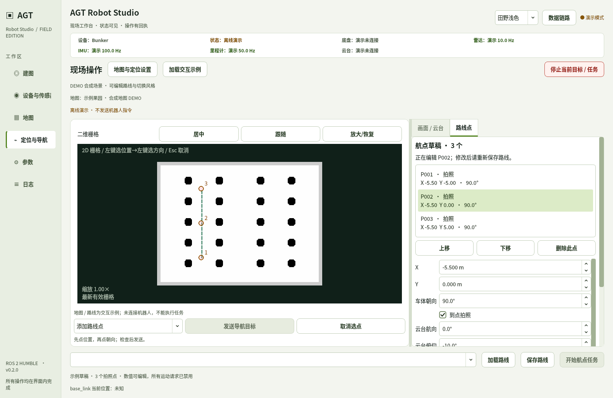
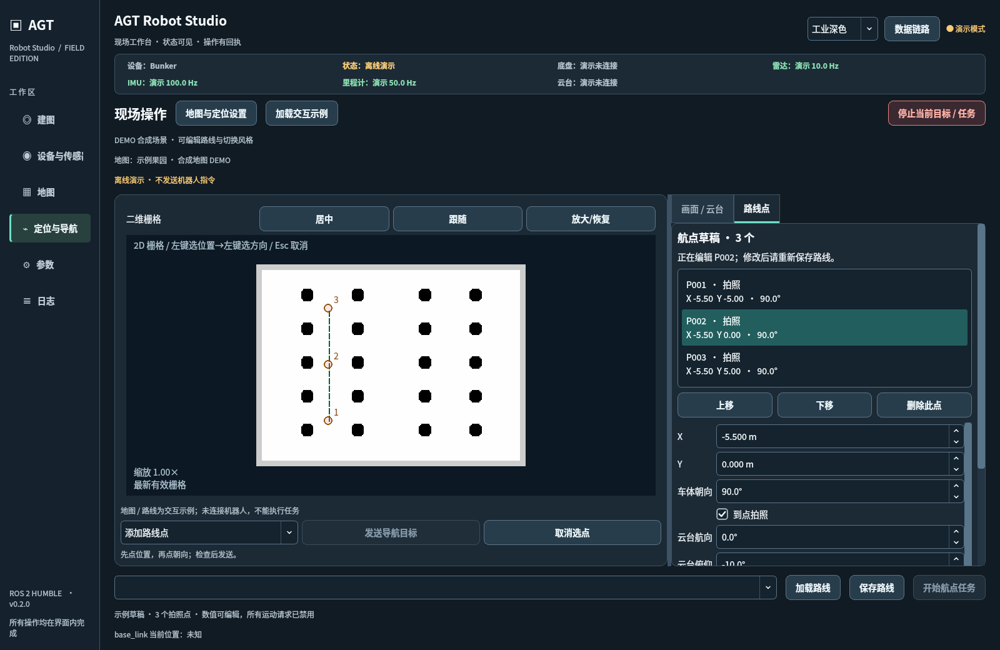
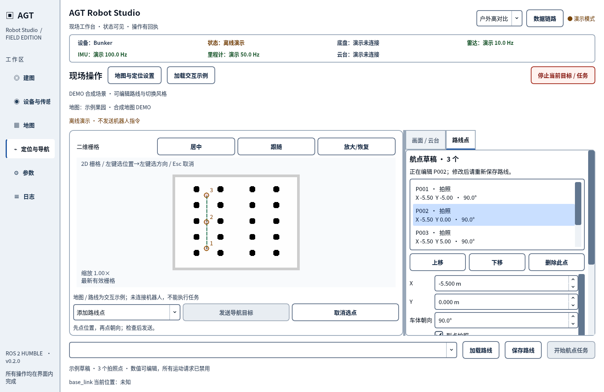
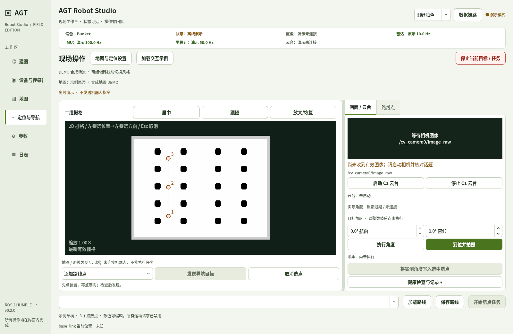
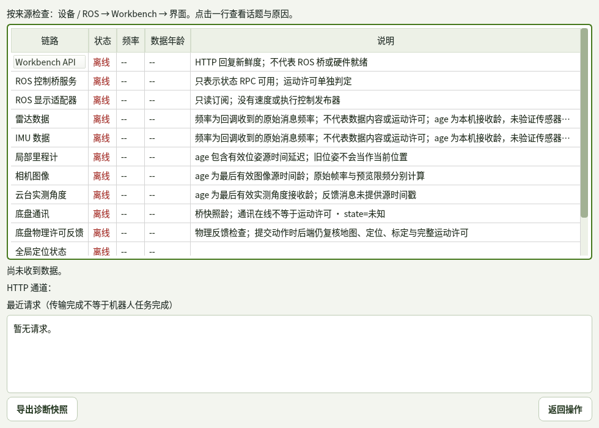
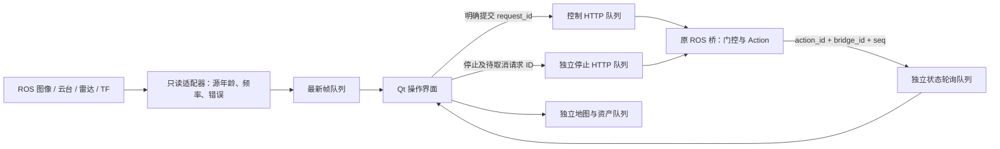

# 三套可切换的现场界面

这些截图由真实 Qt 软件的离线演示直接渲染。地图与路线为合成示例，没有连接机器人；三套风格使用同一套交互和数据接口。

| 选择 | 风格 | 适用场景 | CLI |
| --- | --- | --- | --- |
| A | 田野浅色 | 日常工控机操作，柔和绿灰色，保留当前参考方向 | `--theme field` |
| B | 工业深色 | 室内、夜间调试，青绿主操作与深蓝灰面板 | `--theme industrial` |
| C | 户外高对比 | 较强环境光、需要更大控件；深墨文字、蓝色按钮、清晰边框 | `--theme daylight` |

软件右上角可以直接切换，主题不改变机器人配置、路线内容或执行状态。个人外观保存到
`~/.config/agt_robot_studio/appearance.json`，与标定和运动参数分开。
命令行 `--theme` 优先于已保存外观，且不会自动改写偏好。

## A · 田野浅色



## B · 工业深色



## C · 户外高对比



## 画面与数据来源

右侧可切回相机与云台；实时画面、实际角度和目标输入分别显示。没有硬件时保持未连接状态。



“数据链路”展示 API、ROS 桥、雷达、IMU、里程计、图像、云台、TF、定位和底盘许可的来源、频率、年龄与错误。
API 在线不代表 ROS 桥在线，底盘通讯在线也不代表获准运动。可以导出当前诊断 JSON 快照。



## 试用与部署

已有 ROS 工作区按 [试用手册](../operator_ui_trial.md) 更新并构建 Qt 包后：

```bash
~/.local/bin/agt-robot-studio --demo --theme field
```

点击“加载交互示例”，可以修改示例航点和切换三种风格；离线模式不发送任何运动命令。
省略 `--demo` 才连接现有后端。源码渲染可执行 `python3 scripts/render_studio_themes.py`，无需 ROS。

本次还更新了 Workbench 和 ROS 桥的动作回执协议。部署时须先正常结束当前任务与会话，再按既有部署流程
重启常驻 Workbench 与 ROS 桥。**只重新打开 Qt 不会更新常驻后端**。旧后端缺少动作身份时，界面会明确阻止
发送新运动，提示更新后端；不会退回无法关联回执的执行方式。已有地图、标定与导航门限保持原配置。

## 数据链路改进



- 状态轮询不再排在点云读取、地图保存等长任务后面；GET 有界合并，POST 不自动重试。
- 停止使用独立 HTTP 队列，不排在已阻塞的控制请求后面；晚到原运动请求由请求 ID 取消标记拒绝执行。
- 导航请求、受理、执行与终态按动作身份关联；旧结果、乱序回执和桥重启不能误标本次完成。
- 超时保持“结果未知”；停止使用自己的请求 ID，并关联待取消请求，防止旧命令晚到后执行。
- “停止已下发”不表示已经测得车体静止；现场仍需观察底盘。
- 云台完成只接受当前任务 ID / 请求标记；无关的历史照片不会替代当前动作结果。
- 旧里程计、无效角度、过期图像与断开的适配器不再显示为新鲜数据。

接口细节及测试边界见 [动作协议](../operator_action_protocol.md)。本轮软件测试使用离线界面、真实本机 HTTP/Unix socket
和确定性 ROS Action 测试替身，没有实车或真实 DDS 验证；三主题都还需要在目标屏幕与环境光下试用。

最终联合回归为 **233 passed、1 skipped、1 deselected、79 subtests passed**。唯一跳过项缺真实 B+C bag metadata；
排除项依赖本环境没有的 `rclpy`。可复现命令如下：

```bash
QT_QPA_PLATFORM=offscreen PYTHONPATH=agt_robot_studio python3 -m pytest -q -rs \
  agt_robot_studio/test tests/test_action_status.py tests/test_bridge_actions.py \
  tests/test_control_error_protocol.py tests/test_ui_action_protocol.py \
  tests/test_workbench.py tests/test_goal_safety.py tests/test_device_supervisor.py \
  tests/test_mode_state.py tests/test_session_startup.py tests/test_studio_mapping.py \
  tests/test_studio_desktop.py -k 'not test_photo_start_is_blocked_before_ros_init'
```

地图标注按原始白色栅格检查了文字对比度；主题切换测试确认路线内容不变且不发送请求。启动器的
`--theme` 参数也经过假 ROS 工作区透传测试。截图是离屏渲染，不能证明工控机 GPU、DPI 或真实图像源已通过。
